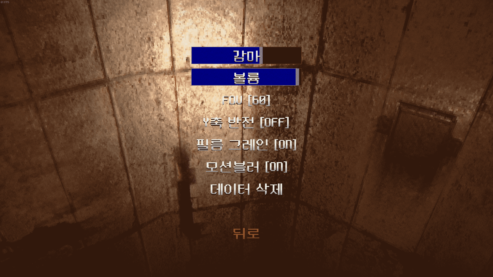

# Lost in Vivo Kor Korean Patch

Lost in Vivo 3.0.5 한글패치 입니다.

버그, 오역 등이 있다면 이슈 등록해주세요.

---

### 한글패치, 한글 이미지 제작
`WHALE59`

### 번역 및 검수
`LK Garlic`

`WHALE59`

---
# 패치내역

### 2024-10-03

타이틀 로고 수정,

일부 오역 수정

### 2024-10-05

일부 오역 수정,

일부 이미지 한글번역,

FOV가 최대여도 멀미가 심해서 최대치를 90까지 올렸습니다.(문제 발생시 제거 예정)

### 2024-10-06

일부 오역 수정,

테이프 선택창 버그 수정,

대부분의 이미지 한글번역

### 2024-10-07

이미지 한글번역 완료,

모니터 주사율에 맞는 프레임레이트를 지원하게 바꿨습니다.(문제 발생시 제거 예정)

### 2024-10-08

DLC 탈출구에서 페이지가 번역되지 않는 버그 수정

### 2026-11-17

라이선스 관련 문제가 있을 수 있어 파일을 덮는 방식에서 xdelta 패치로 변경

---
# Preview

---
# License

xdelta3 (Apache License 2.0) https://github.com/jmacd/xdelta
Dalmoori font (Apache License 2.0) https://ranolp.github.io/dalmoori-font/
Neo 둥근모 font (SIL Open Font License 1.1) https://neodgm.dalgona.dev/
